# VisionX

**A web-based prototype for organizing AICTE approval workflows and institutional compliance.**

Smart India Hackathon 2026 · Problem Statement **SIH26262**

**Problem statement:** Integrated AICTE Approval Workflow Automation, Compliance Monitoring and Alert Management System

## Table of Contents

- [Project Overview](#project-overview)
- [Problem Statement](#problem-statement)
- [Proposed Solution](#proposed-solution)
- [Key Features](#key-features)
- [Technology Stack](#technology-stack)
- [System Architecture](#system-architecture)
- [Project Folder Structure](#project-folder-structure)
- [Installation and Setup](#installation-and-setup)
- [Environment Variables](#environment-variables)
- [Application Screenshots](#application-screenshots)
- [Application Workflow](#application-workflow)
- [Security Considerations](#security-considerations)
- [Current Development Status](#current-development-status)
- [Future Scope](#future-scope)
- [Team Information](#team-information)
- [Contribution](#contribution)
- [Disclaimer](#disclaimer)
- [License](#license)

## Project Overview

VisionX is a web-based student project developed for Smart India Hackathon 2026. It explores how AICTE approval-related work and institutional compliance tracking could be presented through a shared digital interface.

The project addresses the coordination involved in managing approval applications, scrutiny, supporting documents, compliance requirements, and deadlines. Its intended users are educational institutions that prepare and track applications and officers who review applications and monitor compliance.

The current repository contains a **frontend prototype**, not a connected approval service. It demonstrates institution and officer portal screens with sample records and browser-only interactions. It is not connected to AICTE systems, a backend API, or a database.

## Problem Statement

Approval workflows can involve multiple application stages, document checks, institutional requirements, and time-bound follow-ups. When these activities are coordinated manually or across separate channels, it can be difficult for applicants and reviewers to see current progress, identify missing information, and keep deadlines visible.

The SIH problem statement calls for an integrated approach to approval workflow automation, compliance monitoring, and alert management. VisionX is a prototype exploration of that approach; the current code does not automate or submit real approval work.

## Proposed Solution

VisionX presents institution-facing and officer-facing views within one web application. The prototype organizes sample application and compliance records into dashboards, searchable tables, status summaries, notification lists, and reports.

These screens illustrate a possible centralized workflow. Persistent records, real document handling, actual officer decisions, and delivery of alerts require backend services and are not implemented in this repository.

## Key Features

**Status key**

- **Implemented (prototype):** The screen or browser-side interaction is present.
- **Partially implemented:** A user interface or local demonstration exists, but it does not perform the complete real-world workflow.
- **Planned / not implemented:** The capability is not present in the current codebase.

All records and metrics shown by the prototype are hard-coded sample data; they are not live institutional or AICTE data.

### Institution Portal

| Capability | Status | What is present |
|---|---|---|
| Institution dashboard | Partially implemented | A dashboard shows sample application counts, status summaries, compliance highlights, deadlines, and application rows. |
| Institution pages | Implemented (prototype) | Routes and screens exist for applications, compliance, notifications, reports, and settings. |
| Institution account | Planned / not implemented | There is no institution account service or persisted profile. |

### AICTE Officer Portal

| Capability | Status | What is present |
|---|---|---|
| Officer portal navigation and pages | Implemented (prototype) | Officer routes exist for dashboard, applications, compliance, notifications, reports, and settings. |
| Officer dashboard | Partially implemented | The officer dashboard currently reuses the institution dashboard component. |
| Officer review and scrutiny actions | Planned / not implemented | The application list is for display and filtering; reviewers cannot record decisions or advance scrutiny stages. |

### Application Management

| Capability | Status | What is present |
|---|---|---|
| Application list and status summaries | Partially implemented | Pages display hard-coded sample application records and status totals. |
| Search and filters | Implemented (prototype) | Application tables support browser-side text search and status/type filters. |
| Application creation, submission, and status updates | Planned / not implemented | There is no application form, submission API, or persisted status workflow. |

### Compliance Monitoring

| Capability | Status | What is present |
|---|---|---|
| Compliance records and deadlines | Partially implemented | Pages display sample requirements, statuses, and dates. |
| Search and status filtering | Implemented (prototype) | Compliance rows can be filtered in the browser. |
| Automated deadline checks and compliance verification | Planned / not implemented | Dates and statuses are sample values; no scheduler or verification process runs. |

### Document Management

| Capability | Status | What is present |
|---|---|---|
| Document upload, storage, validity tracking, or verification | Planned / not implemented | The code does not include file upload controls or document-processing services. |

### Alerts and Notifications

| Capability | Status | What is present |
|---|---|---|
| Notification list and read/unread views | Partially implemented | Sample notifications can be filtered; marking them read updates local component state. |
| Notification delivery and generated deadline alerts | Planned / not implemented | There is no email, push, or backend notification service. Changes are not persisted. |

### Reports and Dashboard

| Capability | Status | What is present |
|---|---|---|
| Dashboard summaries and report views | Partially implemented | The interface includes sample statistics, a monthly chart, institution summaries, and compliance percentages. |
| Live analytics, report exports, or data-backed metrics | Planned / not implemented | Figures are defined in frontend code and are not calculated from a live dataset. |

## Technology Stack

| Area | Technology |
|---|---|
| UI | React 19 with JSX |
| Routing | React Router DOM 7 |
| Build and development server | Vite 8 |
| Styling | CSS; Tailwind CSS 4 and its Vite plugin are included and configured |
| Language | JavaScript (ES modules) |
| Package manager | npm |

The package manifest is [client/package.json](client/package.json). The current application is client-side only; this repository does not contain a Node/Express API, MongoDB/Mongoose setup, or another application database.

## System Architecture

The current architecture is a single-page React application. Vite serves it during development and builds static assets for preview or hosting. React Router selects the portal screens, and the screens use hard-coded data and in-memory state.

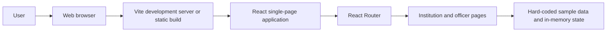

There is no backend or database connection in the current implementation.

## Project Folder Structure

The project is organized as follows. Generated dependencies and build output are omitted:

```text
VisionX/
├── README.md
├── client/
│   ├── .gitignore
│   ├── eslint.config.js
│   ├── index.html
│   ├── package.json
│   ├── package-lock.json
│   ├── README.md
│   ├── vite.config.js
│   ├── public/
│   │   ├── favicon.svg
│   │   └── icons.svg
│   └── src/
│       ├── App.jsx
│       ├── App.css
│       ├── index.css
│       ├── main.jsx
│       ├── assets/
│       │   ├── hero.png
│       │   ├── Logo.png
│       │   ├── LogoBackground.png
│       │   ├── react.svg
│       │   ├── vite.svg
│       │   └── screenshots/
│       │       ├── applications-institution.png
│       │       ├── applications-officer.png
│       │       ├── compliance-institution.png
│       │       ├── compliance-officer.png
│       │       ├── dashboard-officer.png
│       │       ├── login-page.png
│       │       ├── notifications-institution.png
│       │       ├── notifications-officer.png
│       │       ├── reports-institution.png
│       │       ├── reports-officer.png
│       │       ├── settings-institution.png
│       │       └── settings-officer.png
│       ├── components/
│       │   ├── Header.jsx
│       │   ├── Header.css
│       │   ├── Sidebar.jsx
│       │   ├── Sidebar.css
│       │   ├── StatCard.jsx
│       │   └── StatCard.css
│       ├── layouts/
│       │   ├── InstitutionLayout.jsx
│       │   └── OfficerLayout.jsx
│       └── pages/
│           ├── Login.jsx
│           ├── Login.css
│           ├── institution/
│           │   ├── Applications.jsx
│           │   ├── Applications.css
│           │   ├── Compliance.jsx
│           │   ├── Compliance.css
│           │   ├── Dashboard.jsx
│           │   ├── Dashboard.css
│           │   ├── Notifications.jsx
│           │   ├── Notifications.css
│           │   ├── Reports.jsx
│           │   ├── Reports.css
│           │   ├── Settings.jsx
│           │   └── Settings.css
│           └── officer/
│               ├── Applications.jsx
│               ├── Applications.css
│               ├── Compliance.jsx
│               ├── Compliance.css
│               ├── Dashboard.jsx
│               ├── Notifications.jsx
│               ├── Notifications.css
│               ├── Reports.jsx
│               ├── Reports.css
│               ├── Settings.jsx
│               └── Settings.css
├── database/
└── servers/
```

- `client/src/pages/` contains the portal screens.
- `client/src/components/` contains shared interface components.
- `client/src/layouts/` contains the portal layouts.
- `client/src/assets/` and `client/public/` contain the application images, screenshots, and icons.
- `client/dist/` is generated by the build and is excluded from version control.
- The `database/` and `servers/` directories are currently empty.

## Installation and Setup

### Prerequisites

- Node.js **20.19 or newer**, or **22.12 or newer** (required by the configured Vite version).
- npm.
- Git.

### Clone and install

```bash
git clone https://github.com/kunal-codez/VisionX.git
cd VisionX/client
npm install
```

### Run the frontend

From the `client/` directory:

```bash
npm run dev
```

Open the local URL printed by Vite in your browser (commonly `http://localhost:5173`).

### Build and preview

```bash
npm run build
npm run preview
```

### Backend and database

There is currently no backend server or database to start or configure. The available application is the frontend prototype; its sample data is held in the client code and browser memory.

## Environment Variables

The current frontend does not read environment variables, and no `.env` file or `.env.example` is needed to run it. Do not add credentials or connection strings to the client. If a backend or external integration is added later, document its required variables in a separate example file without real secrets.

## Application Screenshots

The screenshots below are included in `client/src/assets/screenshots/`.

### Login

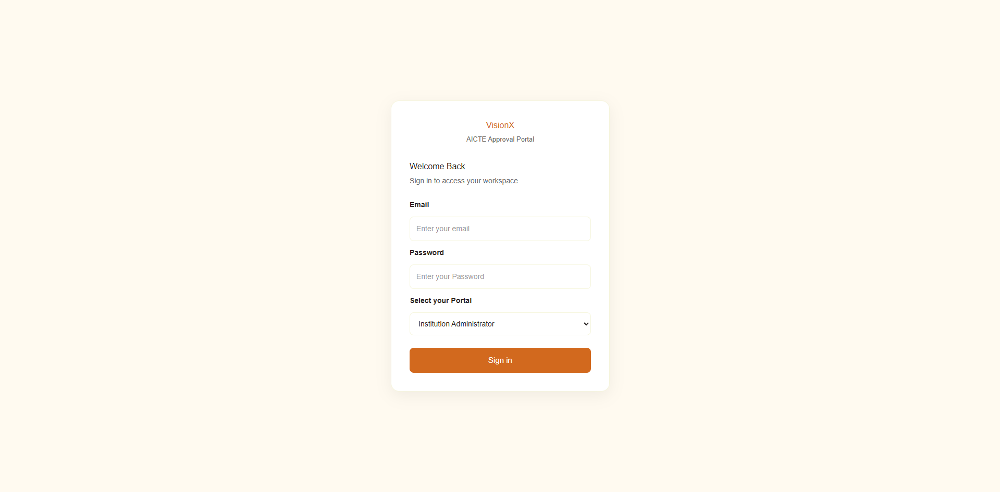

### Dashboards

| Institution Dashboard | Officer Dashboard |
|---|---|
| _Screenshot to be added_ | 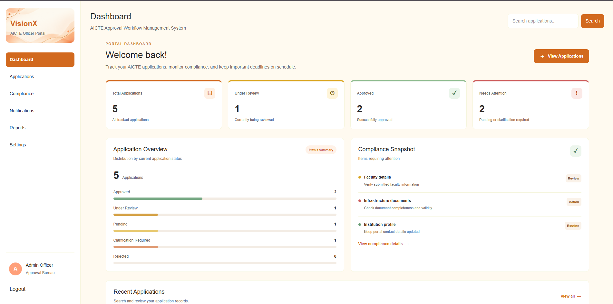 |

### Application Management

| Institution Portal | Officer Portal |
|---|---|
| 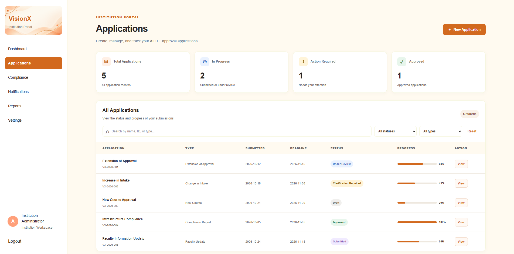 | 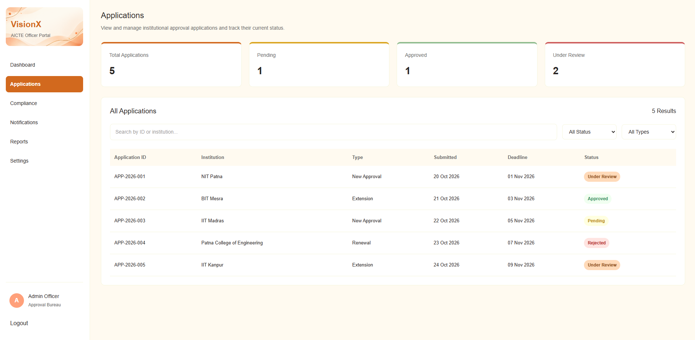 |

### Compliance Monitoring

| Institution Portal | Officer Portal |
|---|---|
| 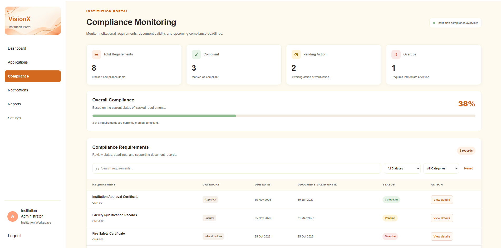 | 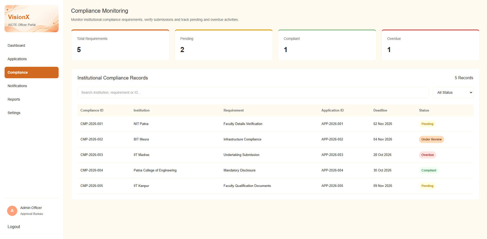 |

### Notifications

| Institution Portal | Officer Portal |
|---|---|
| 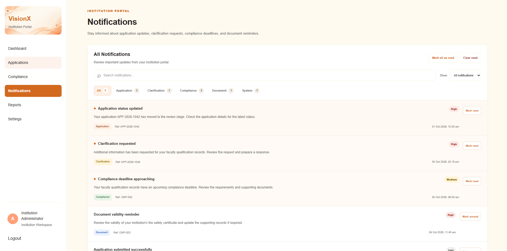 | 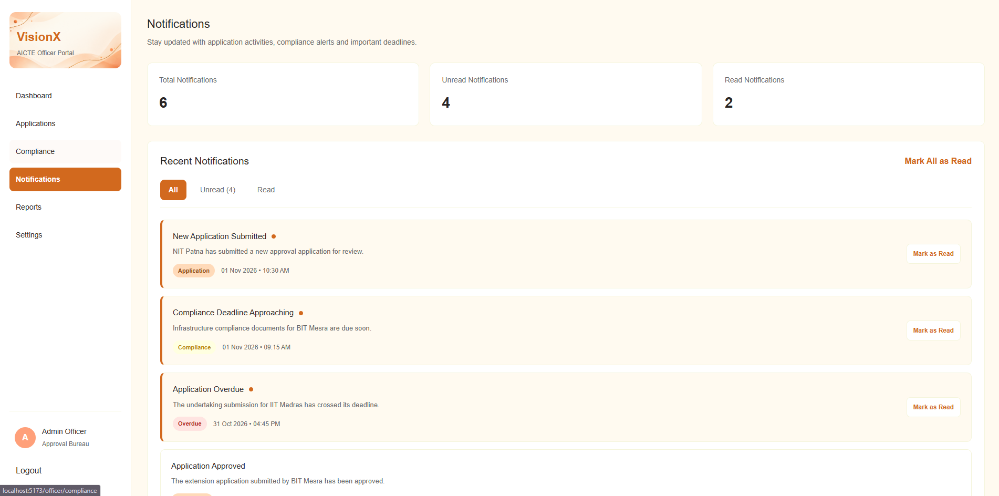 |

### Reports and Settings

| Screen | Screenshot |
|---|---|
| Institution Reports | 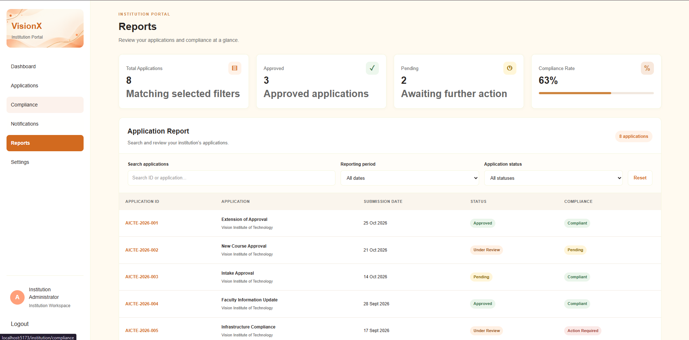 |
| Officer Reports | 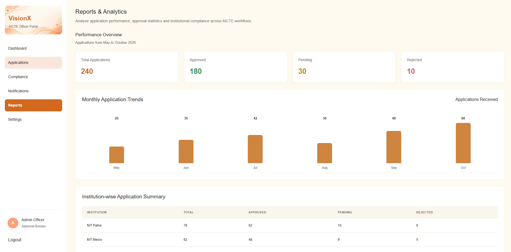 |
| Institution Settings | 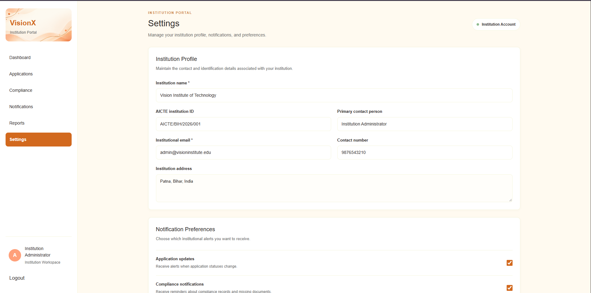 |
| Officer Settings | 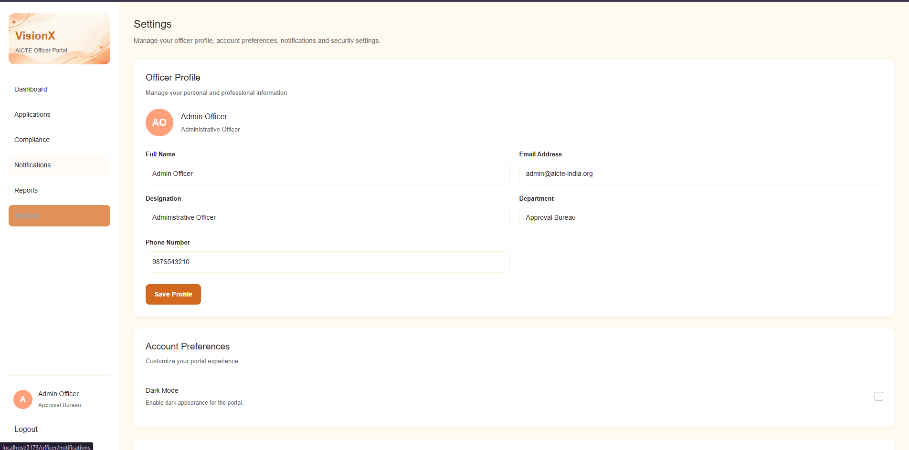 |

## Application Workflow

The sequence below describes the **intended product workflow**, not an end-to-end capability currently implemented by this prototype.

1. **Institution logs in:** The login screen checks for non-empty email and password fields, then routes to the selected portal. It does not authenticate the user.
2. **Institution submits an application:** Application submission is planned; there is no submission form or API.
3. **Required documents are uploaded:** Planned; the current application has no file upload or document storage.
4. **Officer reviews the application:** The officer can view and filter sample application rows. Recording a review decision is not implemented.
5. **Application progresses through scrutiny stages:** The interface does not implement stage transitions or a scrutiny workflow.
6. **Compliance requirements and deadlines are monitored:** Sample requirements and dates are displayed, but checks and deadline calculations are not automated.
7. **Notifications highlight pending and overdue activities:** Sample notifications are shown and can be marked read in browser state; alerts are not generated or delivered by a service.
8. **Institution tracks application status:** Sample statuses are visible in the institution pages; they do not reflect a submitted or live application.

## Security Considerations

- The login form provides basic browser-side required-field handling and routes based on the selected portal. **It is not authentication.**
- Portal routes are not protected by an authorization mechanism. Selecting the officer portal does not verify an officer identity or role.
- Passwords are not sent to or checked by a server, and no password hashing or session management is implemented.
- The prototype has no backend input validation, database access controls, or server-side security boundary.
- Settings form feedback and validation are client-side demonstrations and do not save profile, preference, or password changes to a service.
- Do not use real credentials, personal information, or institutional records with this prototype.

Authentication, authorization, secure persistence, server-side validation, and audit logging should be designed and reviewed before any real-world use.

## Current Development Status

| Status | Verified in this repository |
|---|---|
| **Completed (prototype UI)** | React/Vite application, client-side routes, institution and officer page shells, sample-data tables and dashboard/report views, browser-side search/filter controls, and local notification read-state interactions. |
| **Partially implemented** | Login and settings screens, application/compliance monitoring views, notifications, and dashboards. These demonstrate interface flows but do not use persistent or authoritative data. |
| **In progress** | No feature can be confirmed as actively in progress from the current source code alone. |
| **Planned / not implemented** | Backend APIs, database persistence, real authentication and role authorization, application submission and review transitions, file uploads and verification, automated compliance/deadline processing, and delivered notifications. |

## Future Scope

Possible future work, subject to project requirements and appropriate authorization, includes:

- Add a backend API and persistent data model for institutions, applications, scrutiny stages, and compliance requirements.
- Implement secure authentication and role-based access control for institution and officer accounts.
- Add controlled document upload, validity tracking, and document verification workflows.
- Provide richer compliance analytics and reliable deadline monitoring.
- Deliver notifications through configured channels, with user preferences and delivery status.
- Add audit trails for application and compliance decisions.
- Integrate with authorized external systems only where approval, data-sharing rules, and supported APIs are available.

## Team Information

| Role | Details |
|---|---|
| Team Name | VisionX |
| Team Leader | Kunal Katiyar (2506063) |
| Team Members | Jasmita Jyoti (2513030), Emnunuri Saketh Reddy (2506077), Deepak Yadav (2506076), Vaibhav Kumar (2513050), Shreyash Tripathi (2501034) |
| Institution | National Institute of Technology Patna |

## Contribution

Contributions from the project team can be made through GitHub:

1. Fork the repository or create a feature branch in the project repository.
2. Keep changes focused and avoid committing secrets or real institutional data.
3. From `client/`, run the available checks:

   ```bash
   npm run lint
   npm run build
   ```

4. Open a pull request describing the change and any relevant validation.

## Disclaimer

VisionX is a student-developed prototype prepared for Smart India Hackathon 2026. It is not an official AICTE platform and is not connected to AICTE databases or government infrastructure. It must not be used to submit, verify, or make decisions on real approval applications unless formally authorized and appropriately implemented.

## License

No license has currently been specified. No `LICENSE` file is present in the repository. Until a license is added, reuse and redistribution permissions have not been granted.
